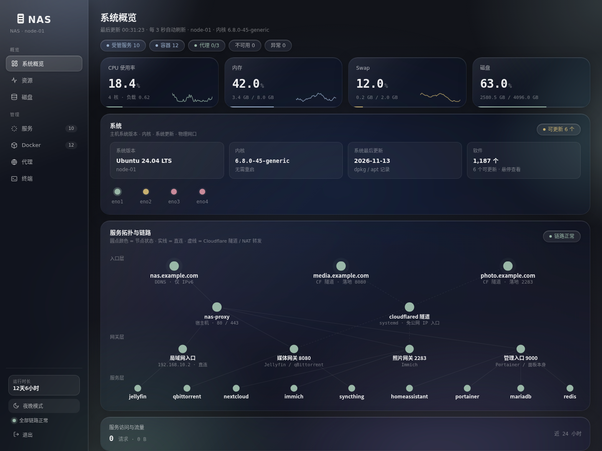
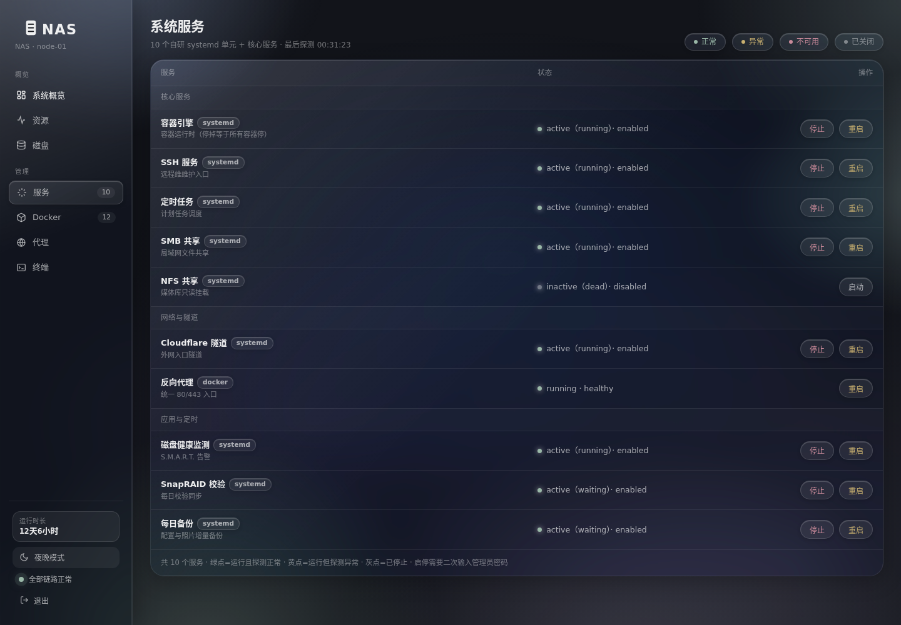
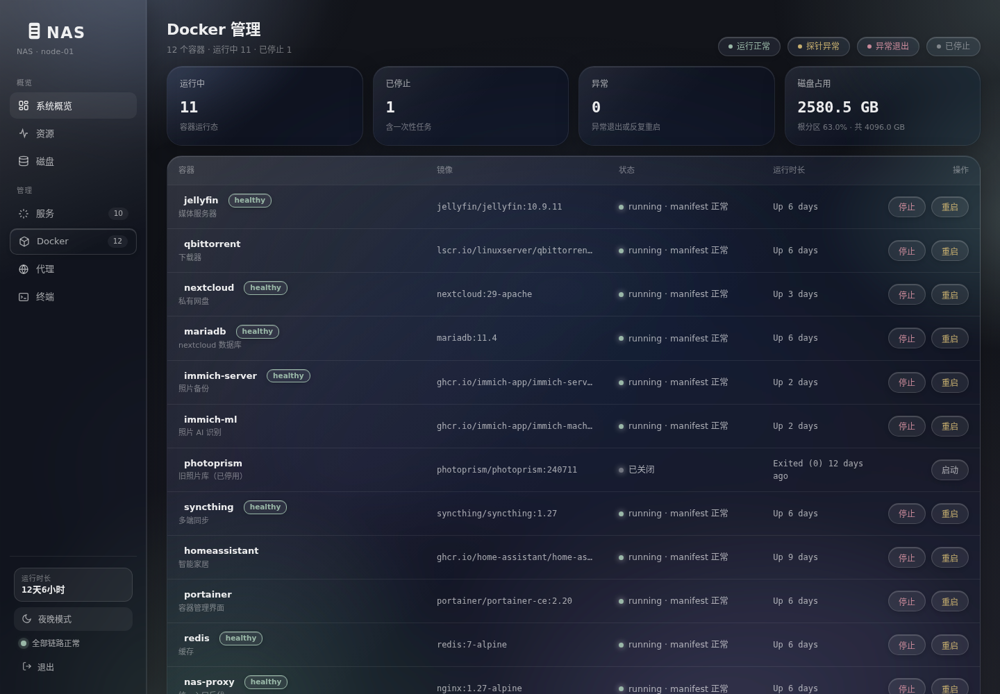
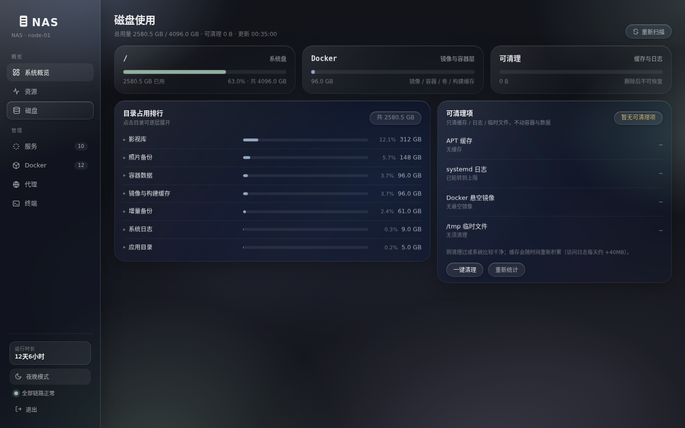
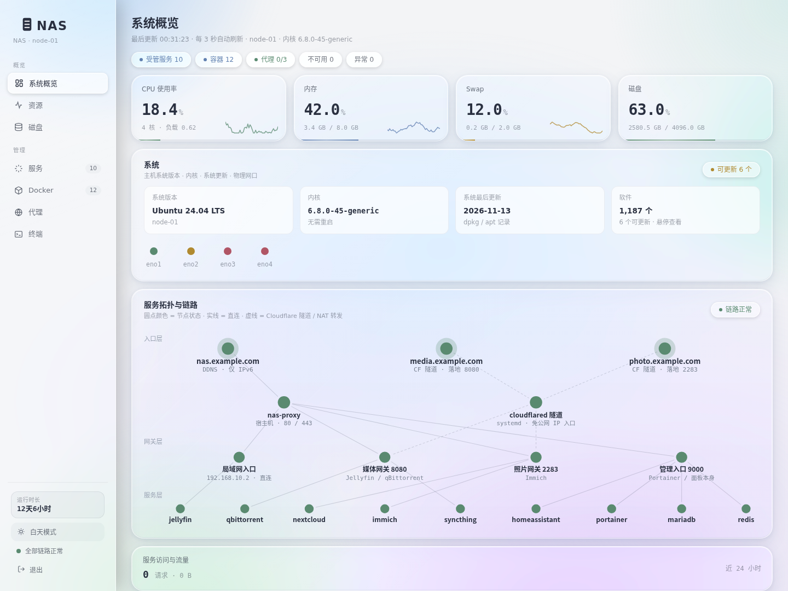
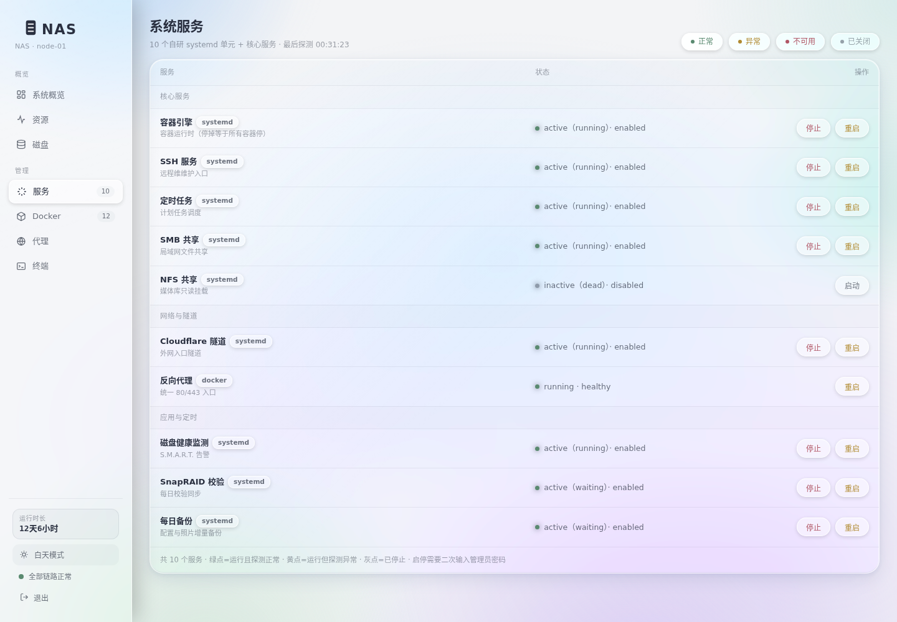
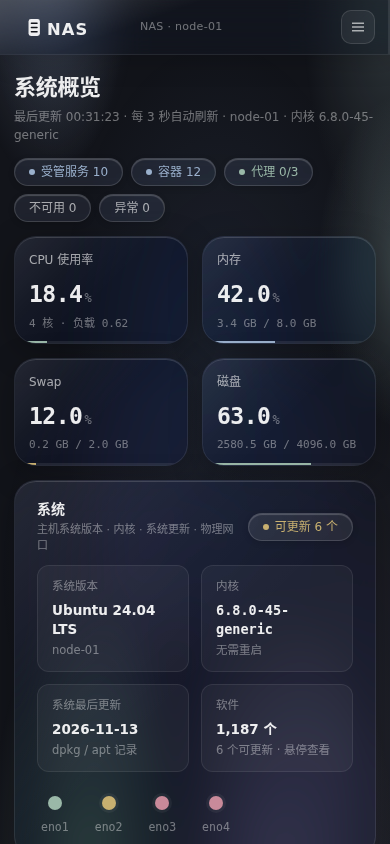

# NAS 系统监控面板

一个**单文件前端 + 纯标准库后端**的家庭 NAS / 小主机监控面板：服务状态灯、Docker 容器管理、
磁盘占用与清理、物理网口状态、网络链路体检、服务拓扑图，全部在一个页面里，手机也能用。

> 本仓库是作者自用面板的**脱敏公开版**：主机名、域名、日志路径、内网拓扑、代理订阅等全部替换为
> `example.com` / `node-01` / `aa:bb:cc:xx` 之类的占位值，代码结构与功能逻辑保持原样。



## 预览

**深色主题**（默认）

| 系统概览 | 系统服务 |
| --- | --- |
|  |  |

| Docker 管理 | 磁盘使用 |
| --- | --- |
|  |  |

**亮色主题**（右下角一键切换，跟随系统偏好）

| 系统概览（亮色） | 系统服务（亮色） |
| --- | --- |
|  |  |

> 两套主题是同一份 CSS 变量表的两组取值，不是两套页面；切换只改 `<html data-theme>`，
> 页面结构、颜色语义、状态灯含义完全一致。

手机 / 窄窗口（≤980px）会自动切换布局：导航收进左上角图标，表格不再横向拖动，隐藏列收进每行的
`⋯` 浮层里。



## 界面与主题的设计灵感

整套视觉围绕一个想法做：**把「机器状态」做成一块能看懂的玻璃仪表盘**，而不是把一堆数字塞进表格。

- **液态玻璃（Liquid Glass）**：卡片、浮层、下拉都用 `backdrop-filter` 做磨砂 + 高光描边，
  背景是缓慢流动的多色光场。灵感来自 Apple 在 WWDC25 提出的 Liquid Glass 视觉语言
  （[Session 219](https://developer.apple.com/videos/play/wwdc2025/219/)）：内容浮在一层有厚度、
  有折射感的玻璃上，而不是贴在纯色底板上。实现上只用 CSS（`backdrop-filter` / `color-mix` /
  渐变描边），没有引入任何图形库。
- **状态即颜色**：绿 = 正常运行、黄 = 运行但异常、红 = 不可用、灰 = 已停止。这套语义在服务列表、
  Docker 列表、网口圆点、拓扑图节点上完全一致——同一个颜色在任何页面都表示同一件事，不需要看图例。
- **深色与亮色两套主题**：深色是默认（夜间看机器状态不刺眼），亮色给白天/投屏用。两套都从同一组
  CSS 变量派生（`--bg-base` / `--card-bg` / `--text-primary` / 状态色），所以深浅切换时布局和
  语义零变化；首次打开跟随系统 `prefers-color-scheme`，手动切换后写入 `localStorage`。
- **拓扑图的分层隐喻**：入口层（域名）→ 网关层（反代/隧道/网关）→ 服务层（容器）。实线表示直连、
  虚线表示隧道或 NAT 转发，节点颜色跟着真实状态变——一眼看出「从外网到某个容器」是哪条链路在断。
- **数字用等宽字体**：所有百分比、容量、时长用 `tabular-nums` 等宽排版，数值跳动时不会左右抖。
- **中文优先排版**：字号阶梯（28/13/12/11.5）按中文可读性调过，行高偏松；状态文案写「已关闭（exit=0）」
  这种人和机器都看得懂的混合表述。
- **响应式不是缩放**：≤980px 收掉侧栏、表格不再横向拖动，隐藏列收进每行的 `⋯` 浮层；
  ≤640px 只保留主列。手机上依然是同一套信息结构，只是层级换了呈现方式。

## 功能

- **系统概览**：CPU / 内存 / Swap / 磁盘四张实时曲线卡；主机版本、内核、最后更新、可更新软件包
  （悬停列出包名）；四个物理网口圆点（绿=活跃、黄=协商异常、红=未连接，悬停看 IP / MAC / 最高速率 / 实际协商速率）
- **服务状态**：systemd 单元 + Docker 容器统一成状态灯（正常 / 异常 / 不可用 / 已关闭），支持
  启动 / 停止 / 重启，写操作要求二次输入管理员密码
- **Docker 管理**：容器列表、镜像、状态、运行时长、健康检查，同样的三键操作（不做删除）
- **磁盘使用**：分区占用、Docker 镜像/卷/构建缓存占用、目录占用排行、可清理项（缓存与日志，不动容器数据）
- **资源与网络**：进程占用排行、链路体检（默认路由 / 光猫 / 外网 / DNS / 隧道）
- **服务拓扑**：入口层 → 网关层 → 服务层的两级连线图，节点颜色跟随真实状态，虚线表示隧道转发
- **响应式**：≤980px 折叠导航、表格改行内浮层；≤640px 只留主列

## 目录结构

```
.
├── index.html                 # 前端：单文件（HTML + CSS + JS，无构建、无依赖）
├── panel.py                   # 后端：Python 3 标准库，无第三方依赖
├── panel.conf.example.json    # 配置样例
├── demo/
│   ├── server.py              # 假后端：任意密码登录，全部返回 fixtures 数据
│   └── fixtures/              # 假数据（NAS 常见容器栈）
└── docs/preview/              # README 用的截图
```

## 一、只看界面（Demo，最省事）

不需要 NAS、不需要 root、不执行任何系统命令：

```bash
git clone <this-repo> && cd <repo>
python3 demo/server.py            # 默认 http://127.0.0.1:8899
# 浏览器打开，密码随便填
```

`demo/server.py` 只做三件事：把 `index.html` 吐给浏览器、`/api/state` `/api/disk` 返回
`demo/fixtures/*.json`、其它 `/api/*` 一律返回「操作成功」。想改数据直接编辑 fixtures。

## 二、真机部署

要求：Linux（systemd）+ Docker + Python 3.9+，**面板需以 root 运行**（要读 systemd、Docker、
`/proc`、`ethtool`，并执行 start/stop/restart）。

```bash
sudo mkdir -p /opt/nas-panel && sudo cp index.html panel.py /opt/nas-panel/
cd /opt/nas-panel

# 1. 生成配置与随机管理员密码（会打印一次，注意保存）
sudo python3 panel.py --init

# 2. 改监听地址与允许来源（默认只允许内网段）
sudo vi panel.conf.json           # allow_cidrs 填你自己的内网网段

# 3. 先手工跑一次，确认能读到状态
sudo python3 panel.py --check

# 4. 常驻
sudo python3 panel.py
```

systemd 单元示例（`/etc/systemd/system/nas-panel.service`）：

```ini
[Unit]
Description=NAS 系统监控面板
After=network-online.target docker.service
Wants=network-online.target

[Service]
Type=simple
WorkingDirectory=/opt/nas-panel
ExecStart=/usr/bin/python3 /opt/nas-panel/panel.py
Restart=always
RestartSec=3

[Install]
WantedBy=multi-user.target
```

```bash
sudo systemctl daemon-reload && sudo systemctl enable --now nas-panel
```

改密码：`sudo python3 panel.py --set-password`。

## 配置项（`panel.conf.json`）

| 键 | 说明 |
| --- | --- |
| `bind` | 监听地址，默认 `0.0.0.0`；只想本机访问就填 `127.0.0.1` |
| `port` | 端口，默认 `8899` |
| `password_hash` | PBKDF2-SHA256 哈希，由 `--init` / `--set-password` 生成，别手写 |
| `allow_cidrs` | 允许访问的来源网段（**第一道门**） |

## 安全模型

- 默认只监听内网，且用 `allow_cidrs` 白名单过滤来源 IP；公网请勿直接暴露
- 登录后发 `HttpOnly + SameSite=Strict` 会话 cookie，写操作还要再输一次管理员密码
- 后端只实现 `start / stop / restart` 三类动作，**代码里不存在 rm / prune / delete 分支**
- `panel.py` 以 root 运行，请只部署在受信任的内网，或前置一层反向代理 + 额外认证

## 脱敏说明

公开版对下列内容做了替换（结构与逻辑未改）：

| 项 | 原值类型 | 现值为 |
| --- | --- | --- |
| 主机名 | 真实机器名 | `node-01` |
| 域名 | 个人子域名 | 统一为 `nas.example.com` / `app.example.com` / `photo.example.com`，**不复用原域名的任何子域名前缀** |
| 日志路径 | `/var/log/<项目名>-panel.log` | `/var/log/nas-panel.log` |
| 拓扑节点 | 真实服务清单 | 通用 NAS 栈（Jellyfin / Immich / Nextcloud…） |
| Demo 数据 | 真实快照 | 手写假数据，网卡 MAC 为 `aa:bb:cc:00:11:0x` |
| 代理订阅 / 节点 | 真实订阅链接与节点名 | Demo 里直接标注「未安装」 |

### 保留项（有意不脱敏）

| 项 | 说明 |
| --- | --- |
| 内网网段 `192.168.x.x` | 按需求保留，仅作示例；不代表任何真实部署地址 |
| 探测目标 `223.5.5.5` / `www.baidu.com` | 公共 DNS 与公共站点，链路体检用，可自行改 `panel.py` 里的常量 |
| 公开软件名 | OpenWrt、HomeProxy、Jellyfin、Immich、Nextcloud、Portainer 等均为开源项目名，不涉及个人信息 |
| 容器名 / 单元名 | 全部为通用命名（`nas-proxy`、`nas-backup.timer` 等），部署时按自己的环境改 |

### 提交与署名

仓库历史只有 1 个提交，提交署名使用 `nas-panel <nas-panel@users.noreply.github.com>`，
不含个人邮箱；历史中不存在任何早期含真实信息的版本。

## 参考与致谢

这个面板是手写实现：**前端零框架、零构建工具，后端只用 Python 标准库**，没有复制任何项目的代码。
下面是在设计与实现过程中参考过的文档、规范和设计语言，按用途分类列出：

### 运行时接口（后端读状态、执行操作）

| 项目 / 文档 | 原始地址 | 用在哪 |
| --- | --- | --- |
| Docker CLI Reference | https://docs.docker.com/reference/cli/docker/ | `docker ps` / `docker system df` 的字段与格式 |
| systemctl / systemd 手册 | https://www.freedesktop.org/software/systemd/man/latest/systemctl.html | `systemctl is-active / show` 解析服务状态 |
| ethtool(8) man page | https://man7.org/linux/man-pages/man8/ethtool.8.html | 读取网口 `Supported link modes` 得到最高速率 |
| proc(5) man page | https://man7.org/linux/man-pages/man5/proc.5.html | `/proc/stat`、`/proc/meminfo`、`/proc/statm` 采样 |
| Cloudflare Tunnel 文档 | https://developers.cloudflare.com/cloudflare-one/connections/connect-networks/ | 隧道入口与 `cloudflared` 状态判定 |
| Python `http.server` | https://docs.python.org/3/library/http.server.html | `ThreadingHTTPServer` 作为后端骨架 |
| ipify | https://www.ipify.org/ | 公网 IPv4 探测（可选链路体检项） |

### 前端视觉与规范

| 项目 / 文档 | 原始地址 | 用在哪 |
| --- | --- | --- |
| Apple Liquid Glass（WWDC25 Session 219） | https://developer.apple.com/videos/play/wwdc2025/219/ | 玻璃卡片的视觉方向（仅设计参考，未使用其代码/资源） |
| MDN `backdrop-filter` | https://developer.mozilla.org/en-US/docs/Web/CSS/backdrop-filter | 卡片磨砂背景与浮层透明效果 |
| MDN `color-mix()` | https://developer.mozilla.org/en-US/docs/Web/CSS/color_value/color-mix | 主题色按比例混合（深浅色自动适配） |
| MDN CSS Grid / `position: sticky` | https://developer.mozilla.org/en-US/docs/Web/CSS/CSS_grid_layout | 卡片栅格与表格首列吸顶 |

### 工具（仅开发/截图时使用，不进入运行时）

| 项目 | 原始地址 | 用途 |
| --- | --- | --- |
| Playwright（Chromium 构建） | https://playwright.dev/ | 无头渲染本仓库 `docs/preview` 里的截图 |
| Chromium | https://www.chromium.org/ | 同上 |

> 图标全部是手写 SVG 路径，字体使用系统字体栈，没有引入任何图标库或 Web Font。

### AI 协作与水印

这个面板的实现过程中有 AI 助手参与，按协作内容在此署名。水印文件在 `docs/brand/`，
是可复用的 SVG（矢量、无外部字体依赖），下方为原图：

<p align="center">
  
</p>

<p align="center">
  
  &nbsp;&nbsp;
  
</p>

| 协作方 | 承担的部分 | 水印文件 |
| --- | --- | --- |
| **DeepSeek（深度求索）** | 代码重构与性能优化：状态采集的并发与缓存策略、`ThreadingHTTPServer` 路由整理、前端表格与浮层的交互修复、问题定位与调试 | `docs/brand/deepseek-watermark.svg` |
| **豆包（Doubao）** | 文案与文档：界面文案、README 结构与说明梳理、脱敏清单校对 | `docs/brand/doubao-watermark.svg` |

> 水印仅用于说明「谁参与了协作」，**不代表任何形式的背书、认证或商业关联**；
> DeepSeek、豆包等名称与标识归其各自权利人所有。如需在自己的二次开发版本中沿用，
> 请保留本段说明并自行确认商标使用合规。


## 开源许可

### 本项目

| 项 | 内容 |
| --- | --- |
| 代码许可 | **MIT**，全文见 [LICENSE](LICENSE) |
| 覆盖范围 | `index.html`、`panel.py`、`demo/`、`docs/`（含预览图与水印 SVG）、`panel.conf.example.json` |
| 署名要求 | 再分发时保留 `LICENSE` 中的版权声明与许可声明 |

### 第三方依赖

| 类别 | 情况 | 许可 |
| --- | --- | --- |
| 前端运行时 | **零依赖**：无框架、无构建工具、无 npm 包、无图标库、无 Web Font（图标是手写 SVG 路径，字体用系统字体栈） | 不涉及 |
| 后端运行时 | **仅 Python 标准库**（`http.server`、`subprocess`、`threading`、`json`、`hashlib`…），无 requirements.txt | 随 Python 发行（PSF-2.0），本项目不再分发 |
| 前端第三方资源 | 无 CDN、无外链脚本 | 不涉及 |

所以把仓库完整克隆下来，不需要 `npm install`、不需要 `pip install`，也不存在许可证传染问题。

### 部署时可能用到的第三方组件

这些只在部署环境里出现，**不在本仓库内分发**，各自遵循原许可：

| 组件 | 许可 | 说明 |
| --- | --- | --- |
| Python 官方镜像 `python:3.x-slim` | PSF-2.0 | 若用 Docker 跑 `panel.py` |
| nginx（含 `nginx:alpine` 镜像） | BSD-2-Clause | 若在前面套反向代理 |
| Docker Engine / CLI | Apache-2.0 | 面板通过 `docker` 命令读取容器状态，属调用而非链接 |
| OpenWrt + HomeProxy 包 | GPL-2.0 / MIT 等（随包） | 代理页读取的是容器内 `uci` 输出 |
| Cloudflare Tunnel（`cloudflared`） | Apache-2.0 | 仅作为被监控对象 |

### 参考文档与设计语言

「参考与致谢」里列出的 MDN、Apple、Docker、systemd 等文档，只作为**规范与设计参考**被阅读，
仓库中不含它们的代码或素材，因此不产生额外的分发义务：

- MDN 文档正文为 CC-BY-SA 2.5，其中的代码示例为 CC0 —— 本项目未复制其示例代码
- Apple「Liquid Glass」仅为视觉方向参考，未使用其任何素材或实现
- 各项目的名称与商标归其权利人所有

### 预览图与水印

`docs/preview/*.png` 由本仓库的 Demo 假数据渲染生成，`docs/brand/*.svg` 为手写矢量文件，
二者同样以 MIT 授权，可自由用于介绍本项目的文章或 README。
